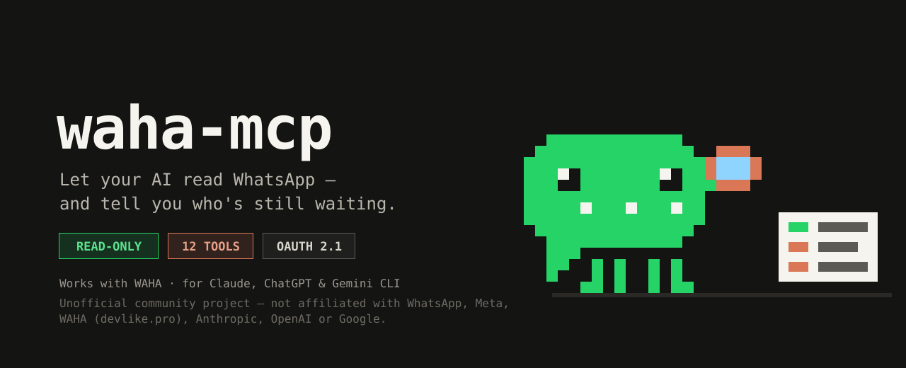
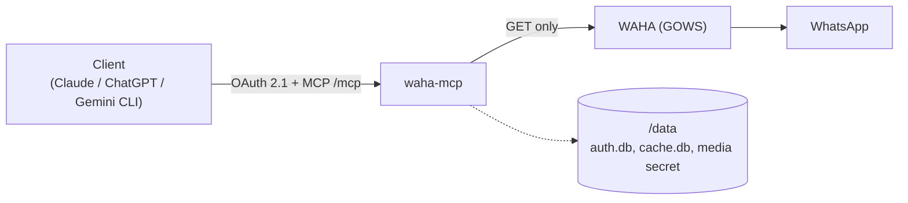

<p align="center">
  
</p>

<h1 align="center">waha-mcp</h1>

<p align="center">
  <strong>Let Claude, ChatGPT and Gemini read your WhatsApp. Read-only, self-hosted.</strong>
</p>

<p align="center">
  <a href="#quick-start">Quick start</a> ·
  <a href="#tools">Tools</a> ·
  <a href="#deploy-on-easypanel">Deploy</a> ·
  <a href="#security-notes">Security</a>
</p>

<p align="center">
  
  
  
  
  
  
  <br>
  
  
  
</p>

<p align="center"><sub>Unofficial community project. Not affiliated with, endorsed by or sponsored by WhatsApp, Meta, WAHA (devlike.pro), Anthropic, OpenAI or Google. All trademarks belong to their respective owners.</sub></p>

---

`waha-mcp` is a **read-only** [MCP](https://modelcontextprotocol.io) server over [WAHA](https://waha.devlike.pro) (the WhatsApp HTTP API). It lets Claude, ChatGPT and Gemini CLI analyze your WhatsApp groups and direct chats: summaries, activity stats, pending replies, search, shared files and media.

Nothing can be sent, edited or deleted: the WAHA client only issues `GET` requests and no tool writes anything.

## What you can ask

- "Who is waiting for my answer since yesterday?"
- "Summarize what happened in _&lt;group&gt;_ this week."
- "Find the PDF Robert sent me."
- "Turn my pending chats into Todoist tasks."

## How it works



## Requirements

- A running WAHA with the **GOWS** engine. WEBJS and NOWEB are not supported in v1: the server still starts, detects the engine and the tools report that it is unsupported.
- Node 24 (the Docker image already includes it) and a public HTTPS URL for the server.

## Quick start

1. **Have WAHA running** with the GOWS engine and a working session.
2. **Run the server** (replace the values):

   ```bash
   docker build -t waha-mcp .
   docker run -d --name waha-mcp -p 3000:3000 \
     -e WAHA_API_URL=http://<waha-host>:3000 \
     -e WAHA_API_KEY=<your-waha-api-key> \
     -e PUBLIC_BASE_URL=https://<your-public-domain> \
     -v waha-mcp-data:/data \
     waha-mcp
   ```

3. **Put it behind HTTPS** at `PUBLIC_BASE_URL` (a reverse proxy such as Traefik) and check `<base>/health`.
4. **Add `<base>/mcp` to your client** and log in with your WAHA API key. See [Connect your client](#connect-your-client).

## Tools

| &nbsp;       | Tool                   | What it does                                                                      |
| ------------ | ---------------------- | --------------------------------------------------------------------------------- |
| **Discover** |                        |                                                                                   |
| 👥           | `list_groups`          | Lists your groups.                                                                |
| 💬           | `list_chats`           | Lists direct (1:1) chats.                                                         |
| ℹ️           | `get_group_info`       | Group details and participants.                                                   |
| 🧑           | `get_contact`          | Identifies a person by id, phone or name: names, shared groups, last interaction. |
| **Read**     |                        |                                                                                   |
| 📜           | `get_messages`         | Reads messages of a chat, newest first, with cursor pagination.                   |
| 🧵           | `get_thread`           | The conversation around a message.                                                |
| 📎           | `get_media`            | Fetches an attachment by `media_id` (inline when small, otherwise a signed link). |
| **Analyze**  |                        |                                                                                   |
| 📊           | `get_chat_stats`       | Counts, rankings, activity and response times for a chat in a period.             |
| ⏳           | `list_pending_replies` | Who is waiting for your answer, longest first.                                    |
| 🗓️           | `get_activity_digest`  | Activity across chats for a day or period.                                        |
| **Find**     |                        |                                                                                   |
| 🔎           | `search_messages`      | Case- and accent-insensitive search in one chat or across chats.                  |
| 📁           | `list_shared_files`    | Documents, media and links shared in chats, with a kind filter.                   |

### Prompts

| Prompt               | What it does                            |
| -------------------- | --------------------------------------- |
| `daily-review`       | Reviews the day's pending chats.        |
| `pending-to-todoist` | Turns pending replies into to-do tasks. |
| `group-summary`      | Summarizes a group.                     |

## Configuration

<details>
<summary><strong>Environment variables</strong></summary>

<br>

All configuration is through environment variables.

| Variable                 | Required | Default     | Description                                                        |
| ------------------------ | -------- | ----------- | ------------------------------------------------------------------ |
| `WAHA_API_URL`           | yes      |             | Base URL of WAHA (internal URL when deployed next to it).          |
| `WAHA_API_KEY`           | yes      |             | WAHA API key. Also the OAuth login secret.                         |
| `PUBLIC_BASE_URL`        | yes      |             | Public HTTPS URL of this server (`http` only for localhost).       |
| `WAHA_SESSION`           | no       | `default`   | WAHA session name.                                                 |
| `DATA_DIR`               | no       | `/data`     | OAuth state (`auth.db`), message cache (`cache.db`), media secret. |
| `PORT`                   | no       | `3000`      | HTTP port.                                                         |
| `TIMEZONE`               | no       | `UTC`       | IANA time zone for dates and day boundaries (`America/Lima`).      |
| `STATS_MAX_MESSAGES`     | no       | `5000`      | Per-chat message cap; fan-out tools read up to 100 chats each.     |
| `MEDIA_LINK_TTL_SECONDS` | no       | `600`       | Lifetime of signed media links.                                    |
| `MEDIA_INLINE_MAX_BYTES` | no       | `5242880`   | Largest file returned inline (5 MiB); larger ones get a link.      |
| `MEDIA_MAX_BYTES`        | no       | `104857600` | Largest file served by `/media/:token` (100 MiB).                  |
| `CACHE_ENABLED`          | no       | `true`      | Keep a SQLite copy of read messages in `DATA_DIR/cache.db`.        |
| `CACHE_REFRESH_HOURS`    | no       | `48`        | Each sync re-reads this window before the newest cached message.   |
| `CACHE_MAX_AGE_DAYS`     | no       | `0`         | Prune cached messages older than N days (`0` keeps them forever).  |

</details>

## Deploy on EasyPanel

<details>
<summary><strong>Step by step</strong></summary>

<br>

1. Create a service in the **same project as WAHA**, from this repository (Dockerfile build) or from a published image.
2. Set `WAHA_API_URL` to the internal service URL, `http://<project>_<service>:3000`, so traffic never leaves the project network. Set `WAHA_API_KEY`, `PUBLIC_BASE_URL` (the domain you assign in step 3) and the optional variables above.
3. Give **only this service** a public HTTPS domain. WAHA stays private.
4. Mount a volume at `/data`, so logins and media links survive redeploys. If `/data` is a root-owned bind mount, run `chown -R 1000:1000` on it (the container runs as the `node` user).
5. Check `https://<your-domain>/health`; it answers `{"status":"ok"}`.

The Docker healthcheck probes `/health` on port 3000; if you change `PORT`, adjust or disable it.

</details>

## Connect your client

<details>
<summary><strong>claude.ai, Claude Code, ChatGPT, Gemini CLI</strong></summary>

<br>

Let `<base>` be your `PUBLIC_BASE_URL`. On the login page, paste your WAHA API key.

- **claude.ai**: Settings > Connectors > add custom connector, URL `<base>/mcp`; complete the OAuth login.
- **Claude Code**: `claude mcp add --transport http waha <base>/mcp`, then authenticate from `/mcp`.
- **ChatGPT**: enable Developer Mode, add a connector with URL `<base>/mcp` and OAuth authentication.
- **Gemini CLI**: in `~/.gemini/settings.json`:

  ```json
  {
    "mcpServers": {
      "waha": { "httpUrl": "<base>/mcp" }
    }
  }
  ```

  then authenticate with `/mcp auth waha`.

To sign out everywhere, open `<base>/logout` and paste the key: it revokes every client and session.

</details>

## Security notes

<details>
<summary><strong>Read before exposing it</strong></summary>

<br>

- OAuth 2.1 with PKCE (S256). Tokens are opaque random values stored only as hashes.
- Direct chats are private data. Use a client you trust with them.
- The API key and WAHA URL are never logged or returned in errors.
- Rotating `WAHA_API_KEY` revokes every issued token at the next start: only a hash of the key is kept in `auth.db` to detect the change. `auth.db` is created with `0600` permissions.
- The message cache (`cache.db`, `0600`) is a copy of the conversations you read, at rest on the server. A chat is cached the first time a tool reads it; later reads ask WAHA only for messages newer than (newest cached − `CACHE_REFRESH_HOURS`), so edits and deletions older than that window are not picked up. A chat read less than 60 s ago is answered without calling WAHA. Logout does not clear it; delete `cache.db` (or set `CACHE_ENABLED=false`) to drop it. Media files are never cached.
- At most 50 OAuth clients can be registered. Clients older than 24 h with no live token are pruned automatically when a new one registers; `<base>/logout` clears them all.

> [!WARNING]
> The login is rate limited per client address (IPv6 grouped by /64) and with a global failure budget. An attacker can therefore lock the owner out temporarily, and logout is also blocked during that window.

> [!WARNING]
> The client address is the last hop of `X-Forwarded-For`, which is only trustworthy behind a reverse proxy that appends it (Traefik on EasyPanel). Do not expose the server directly to the internet.

> [!WARNING]
> Signed media links expire after `MEDIA_LINK_TTL_SECONDS` and behave like bearer credentials until then: anyone holding the link can download that file.

</details>

## Known limitations

> [!NOTE]
> GOWS does not return reactions or polls on the messages endpoint.
>
> The chats list may omit some active chats; pending-reply and digest results say so in their coverage notes.

- Search and digest work on recent history only (there is no own storage); results report their coverage.
- Dates are read in `TIMEZONE`: a bare date (for example `2026-10-01`) means that local day (as `to`, through its last second), and a date-time without offset is read in `TIMEZONE`. A date-time with `Z` or an offset is taken as given.
- Local phone numbers (without country code) are matched by their ending.

## Development

```bash
pnpm install
pnpm test        # vitest
pnpm typecheck
pnpm lint        # biome
pnpm build       # tsc to dist/
pnpm dev         # run from source with .env
```

`pnpm capture -- --group <id> | --chat <id>` captures GOWS payloads from a live WAHA (GET only) and writes them as test fixtures. A scrubber anonymizes names, numbers, ids and text before writing, so no real data is committed.

## License

[MIT](LICENSE)

---

<p align="center">
  <sub>Not affiliated with WhatsApp, Meta, Anthropic, OpenAI or Google. Trademarks belong to their owners. Hero image is an original illustration.</sub>
</p>
