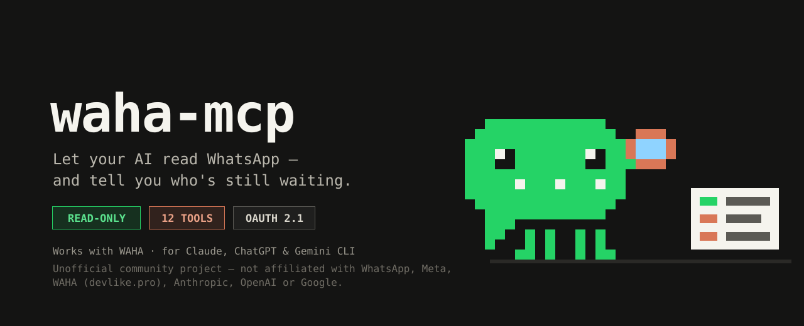
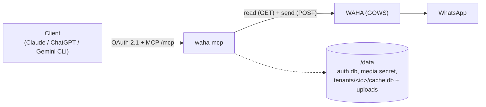

<p align="center">
  
</p>

<h1 align="center">waha-mcp</h1>

<p align="center">
  <strong>Let Claude, ChatGPT and Gemini read your WhatsApp and send messages for you. Self-hosted.</strong>
</p>

<p align="center">
  <a href="#quick-start">Quick start</a> ·
  <a href="#tools">Tools</a> ·
  <a href="#deploy-on-easypanel">Deploy</a> ·
  <a href="#security-notes">Security</a>
</p>

<p align="center">
  
  
  
  
  
  
  <br>
  
  
  
</p>

<p align="center"><sub>Unofficial community project. Not affiliated with, endorsed by or sponsored by WhatsApp, Meta, WAHA (devlike.pro), Anthropic, OpenAI or Google. All trademarks belong to their respective owners.</sub></p>

---

`waha-mcp` is an [MCP](https://modelcontextprotocol.io) server over [WAHA](https://waha.devlike.pro) (the WhatsApp HTTP API). It lets Claude, ChatGPT and Gemini CLI analyze your WhatsApp groups and direct chats (summaries, activity stats, pending replies, search, shared files and media) and send messages from your number: text, images, documents, voice notes, video, locations and contact cards.

Sending tools are marked as writes, so your client asks you to approve every send. Nothing can be edited or deleted. See [Sending](#sending).

## What you can ask

- "Who is waiting for my answer since yesterday?"
- "Summarize what happened in _&lt;group&gt;_ this week."
- "Find the PDF Ana sent me last week."
- "What does the voice note Ana sent this morning say?" (needs [transcription](#voice-note-transcription-optional))
- "Turn my pending chats into Todoist tasks."
- "Reply to Ana that I'll be there at 5, and send her the PDF I just gave you."

## How it works



One server serves several WhatsApp accounts ("tenants"). The admin (you) owns tenant #1, the `WAHA_SESSION` account, and invites friends from the admin tools; each friend signs up with a username and password, pairs their own WhatsApp with a QR code, and only ever sees their own chats. See [Multi-tenant](#multi-tenant).

## Requirements

- A running WAHA with the **GOWS** engine. WEBJS and NOWEB are not supported in v1: the server still starts, detects the engine and the tools report that it is unsupported.
- Node 24 (the Docker image already includes it) and a public HTTPS URL for the server.
- To send media (images, documents, voice notes, video): WAHA 2026.6.1 or later, where the former Plus features ship in the free Core image (or an older WAHA Plus). Text, locations and contacts work on any version.

## Quick start

1. **Have WAHA running** with the GOWS engine and a working session (WAHA Plus, or WAHA 2026.6.1+, to create one session per tenant).
2. **Generate a master key** and keep an offline copy of it (losing it loses every tenant's cached data):

   ```bash
   openssl rand -base64 32
   ```

3. **Run the server** (replace the values):

   ```bash
   docker build -t waha-mcp .
   docker run -d --name waha-mcp -p 3000:3000 \
     -e WAHA_API_URL=http://<waha-host>:3000 \
     -e WAHA_API_KEY=<your-waha-api-key> \
     -e PUBLIC_BASE_URL=https://<your-public-domain> \
     -e MASTER_KEY=<output-of-openssl-rand> \
     -e ADMIN_USERNAME=<your-username> \
     -e ADMIN_PASSWORD=<at-least-12-characters> \
     -v waha-mcp-data:/data \
     waha-mcp
   ```

4. **Put it behind HTTPS** at `PUBLIC_BASE_URL` (a reverse proxy such as Traefik) and check `<base>/health`.
5. **Add `<base>/mcp` to your client** and log in with `ADMIN_USERNAME` and `ADMIN_PASSWORD`. See [Connect your client](#connect-your-client).

## Tools

| &nbsp;       | Tool                   | What it does                                                                      |
| ------------ | ---------------------- | --------------------------------------------------------------------------------- |
| **Discover** |                        |                                                                                   |
| 👥           | `list_groups`          | Lists your groups.                                                                |
| 💬           | `list_chats`           | Lists direct (1:1) chats.                                                         |
| ℹ️           | `get_group_info`       | Group details and participants.                                                   |
| 🧑           | `get_contact`          | Identifies a person by id, phone or name: names, shared groups, last interaction. |
| **Read**     |                        |                                                                                   |
| 📜           | `get_messages`         | Reads messages of a chat, newest first, with cursor pagination.                   |
| 🧵           | `get_thread`           | The conversation around a message.                                                |
| 📎           | `get_media`            | Fetches an attachment by `media_id` (inline when small, otherwise a signed link). |
| 🎙️           | `transcribe_audio`     | Transcribes an audio or voice note by `media_id` (optional, see below).           |
| **Analyze**  |                        |                                                                                   |
| 📊           | `get_chat_stats`       | Counts, rankings, activity and response times for a chat in a period.             |
| ⏳           | `list_pending_replies` | Who is waiting for your answer, longest first.                                    |
| 🗓️           | `get_activity_digest`  | Activity across chats for a day or period.                                        |
| **Find**     |                        |                                                                                   |
| 🔎           | `search_messages`      | Case- and accent-insensitive search in one chat or across chats.                  |
| 📁           | `list_shared_files`    | Documents, media and links shared in chats, with a kind filter.                   |
| **Send**     |                        |                                                                                   |
| ✉️           | `send_text`            | Sends a text, optionally quoting a message and @mentioning people.                |
| ⬆️           | `create_upload_link`   | One-time link to upload a file you gave the model, before sending it.             |
| 🖼️           | `send_media`           | Sends an uploaded file, forwards a WhatsApp attachment or sends a public URL.     |
| 📍           | `send_location`        | Sends a location pin.                                                             |
| 👤           | `send_contact`         | Sends a contact card.                                                             |

### Prompts

| Prompt               | What it does                            |
| -------------------- | --------------------------------------- |
| `daily-review`       | Reviews the day's pending chats.        |
| `pending-to-todoist` | Turns pending replies into to-do tasks. |
| `group-summary`      | Summarizes a group.                     |

## Multi-tenant

Each tenant is one WhatsApp account with one user. Tenant #1 is the admin's: it uses `WAHA_SESSION` and is created on first start from `ADMIN_USERNAME` and `ADMIN_PASSWORD`. It cannot be revoked, restored or deleted.

1. The admin asks the model to `create_invite` for a friend and sends them the link (single use, valid 72 hours).
2. The friend opens it, picks a username and a password (12 characters or more), then scans the QR code at `<base>/pair` with WhatsApp. Each tenant gets its own WAHA session (`t_` + 10 random characters); a WhatsApp number can belong to one tenant only.
3. The friend adds `<base>/mcp` to their client and logs in with that username and password. Every tool works on their own account only: there is no session or tenant argument.

If WhatsApp disconnects later, tools say so and point to `<base>/pair` to scan again. A forgotten password is reset with `reset_password` (a single-use link); the admin's own password can also be reset by starting with `ADMIN_PASSWORD_RESET=1` and the new `ADMIN_PASSWORD`, which also signs the admin out of every client. It applies on every start while it is set, so remove `ADMIN_PASSWORD_RESET` once you have logged in again.

Admin tools, listed only for the admin (members never see them):

| Tool                      | What it does                                                                                                                                                                 |
| ------------------------- | ---------------------------------------------------------------------------------------------------------------------------------------------------------------------------- |
| `list_tenants`            | Every tenant with its status, WhatsApp connection state, creation date and last login. No message data.                                                                      |
| `get_transcription_usage` | Transcription spend per tenant for a range (default: the current month): count, audio seconds and USD cost, plus the total. See [transcription usage](#transcription-usage). |
| `create_invite`           | New tenant + invite link; with `tenant_id`, a new link for a tenant that has not signed up yet.                                                                              |
| `reset_password`          | Single-use password reset link (72 hours) for a tenant's user.                                                                                                               |
| `revoke_tenant`           | Blocks a tenant: its tokens stop working at once and its links answer 404. Data is kept.                                                                                     |
| `restore_tenant`          | Undoes `revoke_tenant`.                                                                                                                                                      |
| `delete_tenant`           | Permanent: account, encryption key, cache and WAHA session. Needs the exact display name.                                                                                    |

Every admin tool call is logged with the tool, the target tenant and the outcome, never secrets.

**Encryption.** Each tenant has its own random data key, stored wrapped by `MASTER_KEY` in `auth.db`. Message bodies, transcripts and uploaded files are encrypted with it (AES-256-GCM) in `DATA_DIR/tenants/<id>/`. Chat ids, message ids and timestamps stay in plaintext (indexes and sync). Deleting a tenant deletes its key from `auth.db`, so leftover copies of its files are unreadable without `MASTER_KEY` and an older copy of `auth.db`: a backup that holds both `auth.db` and `MASTER_KEY` can still decrypt everything in it. This protects tenant content against theft of the data volume, of backups kept apart from `MASTER_KEY`, or of a leaked `cache.db`. It does **not** protect against the server operator, who holds the master key and the WAHA API key, and whose WAHA instance stores each WhatsApp session. The invite page tells friends this in one sentence.

**Rotating `MASTER_KEY`.** Start once with the new key in `MASTER_KEY` and the old one in `MASTER_KEY_PREVIOUS`: every tenant key is rewrapped under the new one. Then remove `MASTER_KEY_PREVIOUS`. If `MASTER_KEY` opens no stored key, the server refuses to start with `MASTER_KEY does not match the stored tenant keys.` and changes nothing.

**Operational requirements:**

- Set `WHATSAPP_DEFAULT_ENGINE=GOWS` on the WAHA container: tenant sessions are created without an engine, so WAHA uses its default, and only GOWS is supported.
- WAHA marks a session `FAILED` when nobody scans its QR in time (for example an invite opened hours later). Opening `<base>/pair` restarts a `STOPPED` or `FAILED` session and shows a fresh QR on the next refresh, so the tenant needs nothing from you. Tenant sessions are named `t_` + 10 characters; tenant #1 uses `WAHA_SESSION`.
- Take WAHA off its public domain: waha-mcp reaches it over the internal network (EasyPanel's project network), and only waha-mcp has a public URL. WAHA holds every tenant's WhatsApp session.
- Keep `MASTER_KEY` only in the deployment's environment, with an offline backup. A lost key loses the cached data of every tenant (WhatsApp itself is not affected; the cache rebuilds from WAHA).
- Transcription uses the single `TRANSCRIPTION_API_KEY`, so every tenant's voice notes are billed to the admin. It stays one global switch.
- `PUBLIC_BASE_URL` must be an origin without a path (`https://mcp.example.com`, not `https://example.com/waha`): the login, invite, reset and pairing pages are served at the root.

### Upgrading from 0.3.0

Stop the 0.3.0 container first: two servers must never run on the same `DATA_DIR`. Then set `MASTER_KEY`, `ADMIN_USERNAME` and `ADMIN_PASSWORD` and start 0.4.0 on that `DATA_DIR`.

`sh scripts/generate-secrets.sh <admin-username>` generates all three into `~/waha-mcp-secrets.env` (mode 600) without printing them, ready to paste into the deployment's environment. The first start, once and resumably:

- creates tenant #1 for `WAHA_SESSION` with your admin user;
- moves `DATA_DIR/cache.db` to `DATA_DIR/tenants/<id>/cache.db` and encrypts its messages and transcripts in place;
- deletes `DATA_DIR/uploads` (pending 0.3.0 uploads, which expire within 15 minutes anyway);
- revokes every existing OAuth client and token.

Your clients are signed out once: log in again with `ADMIN_USERNAME` and `ADMIN_PASSWORD` (the WAHA API key is no longer the login). Back up `DATA_DIR` before upgrading; there is no way back to 0.3.0 once the cache is encrypted.

## Message cache

Enabled by default (`CACHE_ENABLED=true`). The server keeps a SQLite copy of the messages it reads in `DATA_DIR/tenants/<id>/cache.db` (one per tenant, encrypted), so repeated questions about a chat do not re-read its whole history from WAHA. A chat is cached the first time a tool reads it. Later reads ask WAHA only for messages newer than (newest cached message minus `CACHE_REFRESH_HOURS`), and a chat read less than 60 s ago is answered without calling WAHA. `CACHE_MAX_AGE_DAYS` prunes old messages (`0` keeps them forever). Media files are never cached. Set `CACHE_ENABLED=false` to turn it off.

Sizing: every message read is kept, so on a busy account `cache.db` grows without limit by default. Set a retention such as `CACHE_MAX_AGE_DAYS=90` there; older messages are simply read from WAHA again when asked for.

> [!WARNING]
> The cache is a copy of your conversations at rest on the server (`DATA_DIR/tenants/<id>/cache.db`, `0600`, message bodies encrypted with the tenant's key). It is wiped when the tenant's WhatsApp account changes: pairing a different number at `<base>/pair` drops the tenant's runtime, so the next tool call re-checks the account and starts from an empty cache. A session re-linked to another number directly in WAHA (outside `/pair`) is only noticed after the next restart, because the account is checked once per runtime. Logout does not clear the cache: delete that `cache.db` (or set `CACHE_ENABLED=false`) to drop it. Edits and deletions older than the refresh window are not picked up, so a deleted message can stay cached.

## Voice-note transcription (optional)

Off by default. Set `TRANSCRIPTION_API_URL`, `TRANSCRIPTION_API_KEY` and `TRANSCRIPTION_MODEL` together (setting only some of them is a startup error) and any OpenAI-compatible speech-to-text API works. For example, with [OpenRouter](https://openrouter.ai):

```env
TRANSCRIPTION_API_URL=https://openrouter.ai/api/v1
TRANSCRIPTION_API_KEY=sk-or-...
TRANSCRIPTION_MODEL=openai/whisper-large-v3-turbo
# optional language hint (ISO 639 code); omit to auto-detect
TRANSCRIPTION_LANGUAGE=es
```

OpenAI and Groq endpoints also work (the server calls `POST {TRANSCRIPTION_API_URL}/audio/transcriptions`). When on, voice notes returned by `get_messages`, `get_thread`, `list_pending_replies` and `get_activity_digest` carry a `transcript`, `search_messages` also matches stored transcripts, and `transcribe_audio` transcribes any audio or voice note on demand. Automatic transcription is limited by `TRANSCRIPTION_MAX_SECONDS` and `TRANSCRIPTION_MAX_PER_CALL`; coverage notes say which voice notes were skipped (`TRANSCRIPTION_MAX_PER_CALL=0` leaves everything to `transcribe_audio`). Each transcript is stored in `cache.db`, also when `CACHE_ENABLED=false`, so it is never paid twice. Transcripts are not pruned by `CACHE_MAX_AGE_DAYS` and stay after their message is deleted in WhatsApp; they are wiped with the rest of `cache.db` when the account changes (see the message cache warning above), or when you delete the file.

New automatic transcriptions stop starting after 25 s within one tool call so answers stay fast; the coverage note lists the ones "not transcribed yet (time budget)", and the next call picks them up. Each failure is logged as one line `transcription failed status=<code> kind=<kind>` (never the audio, the URL or the key). `kind=auth` means the key was rejected, `kind=config` (HTTP 400/404/405/422) a wrong `TRANSCRIPTION_API_URL` or `TRANSCRIPTION_MODEL`, `kind=rateLimited` a provider limit; the coverage note names the same kind.

### Transcription usage

Every transcription the provider answers is recorded in the central store (`auth.db`, table `transcription_usage`) with its tenant, time, model, audio seconds and cost. Cached transcripts and failed calls cost nothing and are not recorded. Costs come from the provider's `usage.cost`, which OpenRouter returns; with a provider that sends no cost (OpenAI, Groq) the row has no cost, and `get_transcription_usage` reports how many transcriptions it could not price instead of counting them as free. Rows are kept after `delete_tenant` (the tenant shows as deleted) so past spend stays accountable. Recording starts with this version; earlier spend is only in the provider's dashboard. A failed write is logged as `tenant=<id> transcription usage not recorded` and never blocks the transcript.

> [!WARNING]
> With transcription on, the audio of your voice notes is sent to the configured provider (a third party such as OpenRouter). Check its data policy before enabling it.

## Files and PDFs

Only small images and stickers come back inline. Claude does not accept PDFs or other binary files from MCP connectors, and the model cannot open the signed link itself. For documents, PDFs, video and large images, `get_media` returns a short-lived link together with an instruction: the model gives you the link and asks you to download the file and attach it to the chat, so it can read it there. Audio is different: with transcription on, the model uses `transcribe_audio`; with it off, the model gives you the link so you can listen to it (Claude does not read attached audio). The server does not extract text from PDF or Word files.

## Sending

Every sending tool is annotated as a write (`readOnlyHint: false`), so clients ask you to approve each call. The server instructions tell the model to send only what you explicitly asked to send, to show you the final text and recipient first, and never to retry on its own. When WAHA does not confirm a send in time, the tool says the outcome is unknown and the model checks the chat before trying again.

**WhatsApp formatting.** WhatsApp has its own syntax (`*bold*`, `_italic_`, `~strikethrough~`, ` ```monospace``` `, `> quote`, `- ` and `1. ` lists) and no headings, tables or `[text](url)` links. The tool descriptions teach it to the model, and the server converts the usual Markdown (`**bold**`, `# Heading`, links, tables) before sending. Code is left untouched. Each send returns the exact text that went out.

**Attachments without passing bytes through the model.** A file you give the model in the chat is not sent as base64 in the tool call (too slow and too large). Instead:

1. The model calls `create_upload_link` and gets a single-use `/upload/<token>` link that expires after `UPLOAD_TTL_SECONDS`.
2. The file is uploaded to that link: either the model runs the returned `curl -T` command from its code sandbox, or you open the link in a browser and pick the file. For the automatic path, allow your client's code sandbox network access to this server's domain (in Claude: Settings → Capabilities → code execution network access).
3. The model calls `send_media` with the `upload_id`. The server passes the file to WAHA directly and deletes it once WAHA confirms the send.

`send_media` also forwards a file already in WhatsApp (`media_id` from the read tools) or sends a public `https` URL. The message kind follows the file type (image, video, audio as a voice note, anything else as a document); `as: "document"` sends a photo without compression.

## Configuration

<details>
<summary><strong>Environment variables</strong></summary>

<br>

All configuration is through environment variables.

| Variable                     | Required | Default     | Description                                                                 |
| ---------------------------- | -------- | ----------- | --------------------------------------------------------------------------- |
| `WAHA_API_URL`               | yes      |             | Base URL of WAHA (internal URL when deployed next to it).                   |
| `WAHA_API_KEY`               | yes      |             | WAHA API key (never shown to users).                                        |
| `PUBLIC_BASE_URL`            | yes      |             | Public HTTPS origin of this server, no path (`http` only for localhost).    |
| `MASTER_KEY`                 | yes      |             | 32 bytes in base64 (`openssl rand -base64 32`); wraps every tenant key.     |
| `MASTER_KEY_PREVIOUS`        | no       |             | Old master key, only for the start that rotates `MASTER_KEY`.               |
| `ADMIN_USERNAME`             | yes      |             | Admin username, 3-32 of `A-Z a-z 0-9 . - _`; created on first start.        |
| `ADMIN_PASSWORD`             | yes      |             | Admin password (12+ characters); read only to create the admin or reset it. |
| `ADMIN_PASSWORD_RESET`       | no       | `false`     | `1`/`true`: reset admin password and sessions on every start; then unset.   |
| `WAHA_SESSION`               | no       | `default`   | WAHA session of the admin's tenant (tenant #1).                             |
| `DATA_DIR`                   | no       | `/data`     | `auth.db` (users, tenants, OAuth), media secret, `tenants/<id>/` data.      |
| `PORT`                       | no       | `3000`      | HTTP port.                                                                  |
| `TIMEZONE`                   | no       | `UTC`       | IANA time zone for dates and day boundaries (`America/Lima`).               |
| `STATS_MAX_MESSAGES`         | no       | `5000`      | Per-chat message cap; fan-out tools read up to 100 chats each.              |
| `MEDIA_LINK_TTL_SECONDS`     | no       | `600`       | Lifetime of signed media links.                                             |
| `MEDIA_INLINE_MAX_BYTES`     | no       | `5242880`   | Largest file returned inline (5 MiB); larger ones get a link.               |
| `MEDIA_MAX_BYTES`            | no       | `104857600` | Largest file served by `/media/:token` (100 MiB).                           |
| `UPLOAD_MAX_BYTES`           | no       | `67108864`  | Largest file accepted by `/upload/:token` (64 MiB).                         |
| `UPLOAD_TTL_SECONDS`         | no       | `900`       | Lifetime of an upload link and of the file it receives.                     |
| `CACHE_ENABLED`              | no       | `true`      | Keep a SQLite copy of read messages in `DATA_DIR/cache.db`.                 |
| `CACHE_REFRESH_HOURS`        | no       | `48`        | Each sync re-reads this window before the newest cached message.            |
| `CACHE_MAX_AGE_DAYS`         | no       | `0`         | Prune cached messages older than N days (`0` keeps them forever).           |
| `TRANSCRIPTION_API_URL`      | no       |             | OpenAI-compatible speech-to-text base URL (`https://openrouter.ai/api/v1`). |
| `TRANSCRIPTION_API_KEY`      | no       |             | API key of that provider.                                                   |
| `TRANSCRIPTION_MODEL`        | no       |             | Model id (`openai/whisper-large-v3-turbo`).                                 |
| `TRANSCRIPTION_LANGUAGE`     | no       |             | Language hint, lowercase ISO 639-1/639-2 code (e.g. `es`); omit to detect.  |
| `TRANSCRIPTION_MAX_SECONDS`  | no       | `300`       | Longer voice notes are not transcribed automatically.                       |
| `TRANSCRIPTION_MAX_PER_CALL` | no       | `20`        | New automatic transcriptions per tool call (`0` = only `transcribe_audio`). |

Transcription is off unless `TRANSCRIPTION_API_URL`, `TRANSCRIPTION_API_KEY` and `TRANSCRIPTION_MODEL` are all set (setting only some of them is a startup error). The server calls `POST {TRANSCRIPTION_API_URL}/audio/transcriptions` with OpenAI-style multipart (`file`, `model`, `language`), which OpenRouter, OpenAI and Groq accept. When on, voice notes in `get_messages`, `get_thread`, `list_pending_replies` and `get_activity_digest` get a `transcript` (within the limits above; coverage notes report the skipped ones), `search_messages` also matches stored transcripts, and each transcript is stored in the tenant's `cache.db` so it is never paid twice. One provider key serves every tenant, so all transcription is billed to the admin.

</details>

## Deploy on EasyPanel

<details>
<summary><strong>Step by step</strong></summary>

<br>

1. Create a service in the **same project as WAHA**, from this repository (Dockerfile build) or from a published image.
2. Set `WAHA_API_URL` to the internal service URL, `http://<project>_<service>:3000`, so traffic never leaves the project network. Set `WAHA_API_KEY`, `PUBLIC_BASE_URL` (the domain you assign in step 3), `MASTER_KEY`, `ADMIN_USERNAME`, `ADMIN_PASSWORD` and the optional variables above. Keep an offline copy of `MASTER_KEY`.
3. Give **only this service** a public HTTPS domain. Remove WAHA's public domain: it stays private.
4. Mount a volume at `/data`, so logins and media links survive redeploys. If `/data` is a root-owned bind mount, run `chown -R 1000:1000` on it (the container runs as the `node` user).
5. Check `https://<your-domain>/health`; it answers `{"status":"ok"}`.

The Docker healthcheck probes `/health` on port 3000; if you change `PORT`, adjust or disable it.

</details>

## Connect your client

<details>
<summary><strong>claude.ai, Claude Code, ChatGPT, Gemini CLI</strong></summary>

<br>

Let `<base>` be your `PUBLIC_BASE_URL`. On the login page, enter your username and password (the admin's are `ADMIN_USERNAME` and `ADMIN_PASSWORD`; friends use the ones they chose on their invite).

- **claude.ai**: Settings > Connectors > add custom connector, URL `<base>/mcp`; complete the OAuth login.
- **Claude Code**: `claude mcp add --transport http waha <base>/mcp`, then authenticate from `/mcp`.
- **ChatGPT**: enable Developer Mode, add a connector with URL `<base>/mcp` and OAuth authentication.
- **Gemini CLI**: in `~/.gemini/settings.json`:

  ```json
  {
    "mcpServers": {
      "waha": { "httpUrl": "<base>/mcp" }
    }
  }
  ```

  then authenticate with `/mcp auth waha`.

To sign out everywhere, open `<base>/logout` and log in: it revokes every client and token of that user (other users are not affected).

</details>

## Security notes

<details>
<summary><strong>Read before exposing it</strong></summary>

<br>

- OAuth 2.1 with PKCE (S256). Tokens are opaque random values stored only as hashes.
- Direct chats are private data. Use a client you trust with them.
- The API key and WAHA URL are never logged or returned in errors.
- Passwords are hashed with scrypt and a per-user salt; invite and reset links are single use and stored only as hashes.
- `MASTER_KEY`, data keys, passwords and link tokens are never logged, stored in plaintext or returned in errors. See [Multi-tenant](#multi-tenant) for what the encryption does and does not protect against.
- Rotating `WAHA_API_KEY` signs every user out at the next start (every OAuth client, code and token is revoked; users log in again with their username and password): only a hash of the key is kept in `auth.db` to detect the change. `auth.db` is created with `0600` permissions.
- The message cache is a copy of the conversations you read: see [Message cache](#message-cache).
- Transcription is off by default; when on, voice notes go to the configured provider: see [Voice-note transcription](#voice-note-transcription-optional). `TRANSCRIPTION_API_KEY` is never logged or returned; provider errors are reported with fixed messages.
- At most 50 OAuth clients can wait unbound (registered, but nobody has logged in through them yet), all users together; clients bound to a user do not count. Unbound registrations are pruned after 1 hour, and bound clients older than 24 h with no live token after 24 hours, whenever a new client registers.

> [!WARNING]
> The login (OAuth, logout, invite, reset and pairing pages share one limiter) is rate limited per client address (IPv6 grouped by /64) and with a global failure budget. An attacker can therefore lock users out temporarily, and logout is also blocked during that window.

> [!WARNING]
> The client address is the last hop of `X-Forwarded-For`, which is only trustworthy behind a reverse proxy that appends it (Traefik on EasyPanel). Do not expose the server directly to the internet.

> [!WARNING]
> Any client you connect can send WhatsApp messages from your number, subject to the approval prompt of that client. Only connect clients you trust, and keep approvals on for the sending tools.

> [!WARNING]
> Upload links work once, expire after `UPLOAD_TTL_SECONDS`, are capped at `UPLOAD_MAX_BYTES` and never talk to WAHA; until used, anyone holding one can put one file in that slot. Uploaded files are stored encrypted with `0600` permissions in `DATA_DIR/tenants/<id>/uploads` and deleted after sending or expiry.

> [!WARNING]
> Signed media links expire after `MEDIA_LINK_TTL_SECONDS` and behave like bearer credentials until then: anyone holding the link can download that file. Links are bound to their tenant: a revoked tenant's links answer 404, the same answer as a forged or unknown link.

</details>

## Known limitations

> [!NOTE]
> GOWS does not return reactions or polls on the messages endpoint.
>
> The chats list may omit some active chats; pending-reply and digest results say so in their coverage notes.

- Search and digest work on the history WAHA still returns and the cache has already read; results report their coverage.
- Dates are read in `TIMEZONE`: a bare date (for example `2026-10-01`) means that local day (as `to`, through its last second), and a date-time without offset is read in `TIMEZONE`. A date-time with `Z` or an offset is taken as given.
- Local phone numbers (without country code) are matched by their ending.

## Development

```bash
pnpm install
pnpm test        # vitest
pnpm typecheck
pnpm lint        # biome
pnpm build       # tsc to dist/
pnpm dev         # run from source with .env
```

`pnpm capture -- --group <id> | --chat <id>` captures GOWS payloads from a live WAHA (GET only) and writes them as test fixtures. A scrubber anonymizes names, numbers, ids and text before writing, so no real data is committed.

## License

[MIT](LICENSE)

---

<p align="center">
  <sub>Not affiliated with WhatsApp, Meta, Anthropic, OpenAI or Google. Trademarks belong to their owners. Hero image is an original illustration.</sub>
</p>
